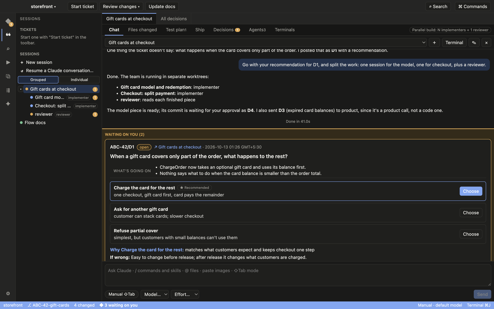
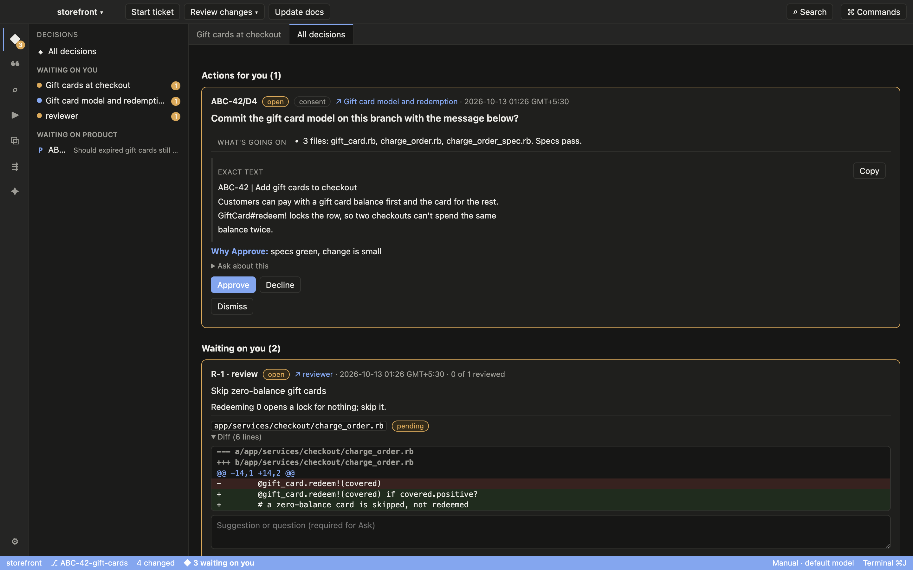
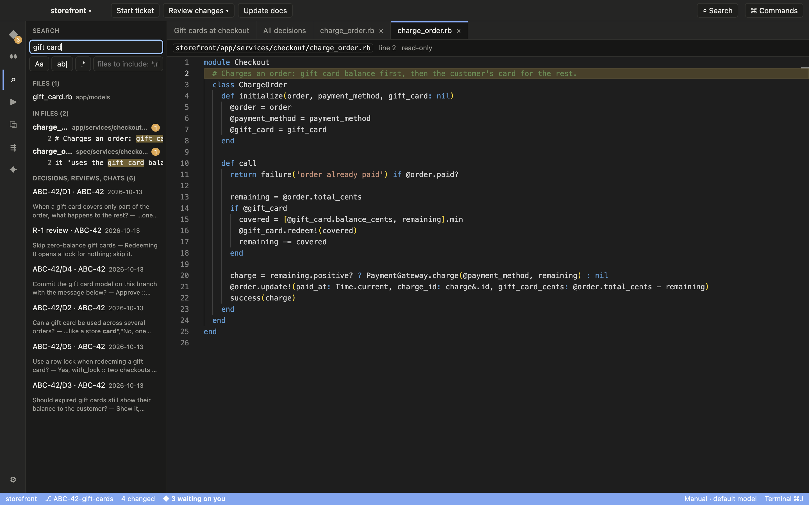
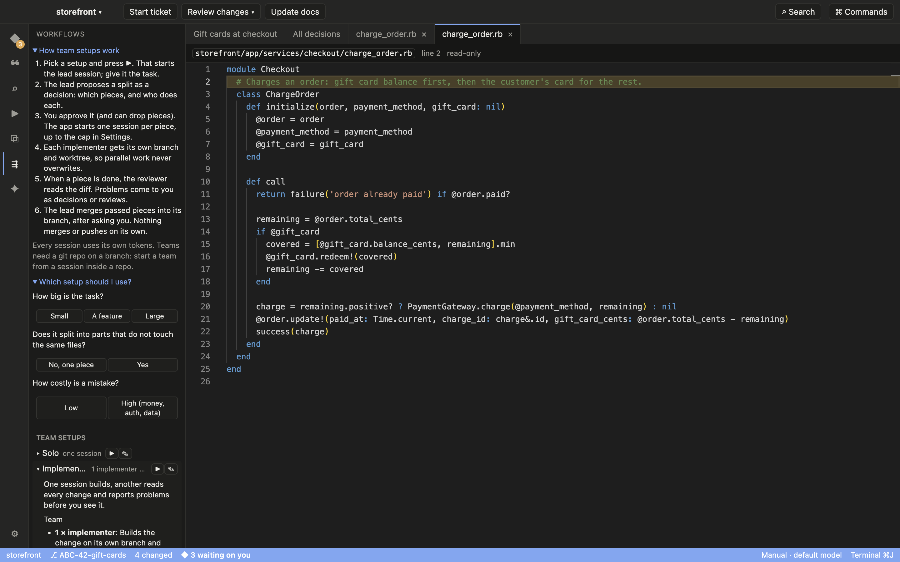
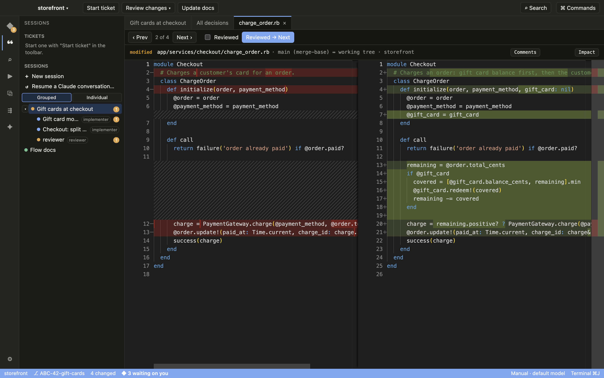
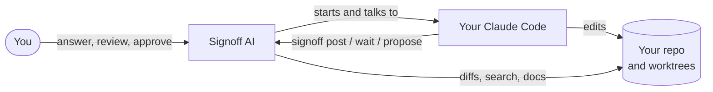

<p align="center">
  
</p>

<h1 align="center">Signoff AI</h1>

<p align="center">
  <b>Claude builds. You sign off.</b><br>
  A desktop app over your own Claude Code: Claude does the work, you make the calls.
</p>

<p align="center">
  <a href="https://github.com/harshdigi/signoff-ai/releases"></a>
  
  <a href="LICENSE.md"></a>
  <a href="SECURITY.md"></a>
</p>

<p align="center">
  
</p>

---

## Why Signoff AI

Working with an AI coding agent in a terminal means scrolling back to find what it asked, re-reading diffs to see what
changed, and hoping nothing slipped past. Signoff AI turns that into a calm loop:

- **Claude asks, you decide.** Every real question becomes a card with context, options, a recommendation, the code it
  points at, and what a wrong call would cost. One click answers it, and the answer reaches the session.
- **You review, not re-read.** Changes are grouped by ticket, session, commit or today, with a side-by-side diff,
  "Reviewed → Next", and comments that go straight back to Claude.
- **Nothing leaves without you.** Commits, pushes, PRs and messages are drafts you approve one at a time.

It runs your own installed Claude Code with your own login. No API keys, no telemetry, nothing sent anywhere by the app.

## A tour

<table>
  <tr>
    <td width="50%"></td>
    <td width="50%"></td>
  </tr>
  <tr>
    <td><b>Decisions.</b> Everything waiting on you in one place: actions to approve (with the exact commit message),
    reviews from the team, and questions you sent to product.</td>
    <td><b>Review.</b> Walk the files of a ticket with Prev / Next and mark each reviewed. Select lines to comment;
    the comment and Claude's reply show by the code and in the chat.</td>
  </tr>
  <tr>
    <td width="50%"></td>
    <td width="50%"></td>
  </tr>
  <tr>
    <td><b>Search.</b> One box for file names, code, decisions, reviews and chats. Results open read-only at the line.</td>
    <td><b>Teams.</b> Split a task across implementers on their own branches, with a reviewer checking each piece.
    The app explains each setup and helps you pick one.</td>
  </tr>
  <tr>
    <td width="50%"></td>
    <td width="50%"></td>
  </tr>
  <tr>
    <td><b>Test plan.</b> Cases drafted with Claude, verified with evidence, and the specs changed in the ticket with a
    one-click run and a report.</td>
    <td></td>
  </tr>
</table>

## Ways to use it

**Work a ticket on your own.** Open your repo, start a session, paste the ticket. Claude plans, asks what the ticket
leaves open as decisions, and builds. You answer cards, review the diff, approve the commit.

**Run a team on a bigger ticket.** Start the lead with a team setup (or ask Claude to propose one). It splits the work;
you approve the split; each implementer gets its own worktree and branch; a reviewer reads every finished piece; the
lead merges them one at a time after asking you.

**Review someone's (or something's) work.** Pick a session and the **Ticket**, **Session**, **Today**, **Commit** or
**Uncommitted** scope. Hover any code reference in a reply (`ChargeOrder#call`, `gift_card.rb:8`) to see the code;
click to open it.

**Keep docs of how your code works.** Let Claude write flow docs for your project: each claim tied to a `file:line`.
Every session reads them before changing code, and is told which docs a change may have made wrong.

**Park a product question.** Mark a decision "Open for product" with what you need. It stops blocking you, the
session keeps working, and **Copy for product** gives you a clean list to paste into Slack or Jira.

**Use it with Claude in your terminal.** Turn on **Settings → Terminal integration** and `claude` sessions you start
in a terminal show up in the app too. Decisions, reviews and approvals work the same.

## How it works



Claude Code sessions run in tmux, so the same session works from the app and from a terminal. They talk to the app
through the `signoff` command (decisions, reviews, test plans, team splits), which the app puts on their path.

## Install (macOS)

1. Download the latest version from [Releases](https://github.com/harshdigi/signoff-ai/releases), or from a terminal:

   ```bash
   curl -LO https://github.com/harshdigi/signoff-ai/releases/latest/download/signoff-ai.dmg
   ```

   Open the `.dmg` and drag **Signoff AI** into Applications.
2. First launch only: macOS blocks apps that are not notarized yet. Open it, click **Done**, then
   **System Settings → Privacy & Security → Open Anyway**.
3. The Setup screen checks Claude Code, sign-in, git and tmux and installs what is missing.

You need macOS 13 or newer and a Claude plan that includes Claude Code (Pro, Max, Team or Enterprise).
More in [INSTALL.md](INSTALL.md).

## Build from source

```bash
npm ci
npm test
npm run dist:mac:friends    # dist/signoff-ai-<version>.dmg
npm run dev                 # run in development
```

## Security

Sandboxed window, hardened runtime, Electron fuses set, every outward action approved by you, and an SBOM for what
ships. Read [SECURITY.md](SECURITY.md), the full [security audit](docs/security-audit.md) and the
[SBOM](sbom/README.md).

## License

[Functional Source License 1.1, Apache 2.0 Future License](LICENSE.md) (FSL-1.1-ALv2). You can read, use, change
and share the code for any purpose except offering a competing product or service. Each release becomes Apache 2.0
two years after it is published.

<p align="center">Written by <a href="https://github.com/harshdigi">harshdigi</a></p>
